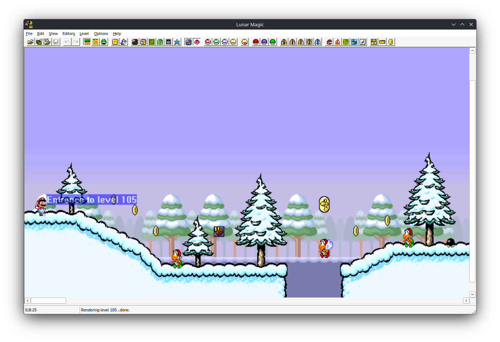

**sdw_stitched** is a custom patch for Super Mario World that provides a Super Demo World: TLC ROM that can be opened with Lunar Magic ("unlocked"). The only real purpose of this is TAS investigations and should not be used to create derivatives or steal resources.

## What works

* Level data: Largely correct. Some secondary entrances look wrong.
* Graphics: All except ExAnimation.

## What doesn't 

* No Overworld.
* Not playable in an emulator.
* ExAnimation graphics.
* No custom ASM inserted.
* No message box messages.

## How

There are two problems with unlocking Super Demo World: 
1. The patch provided by FuSoYa is ExHiROM, which is not supported by the public build of Lunar Magic. 
2. The patch has LM protections ("locking"), so LM will refuse to open it.

We can remove (2) trivially using an application called Recover Lunar Magic (with some minor source code tweaks so it supports ExHiROM), but (1) is much more challenging.

So the actual process is this:
1. Change Recover Lunar Magic ("RLM") to support ExHiROM.
2. Unlock Super Demo World.
3. Extract the levels and graphics from the ROM.
4. Get a clean ROM and save it once in Lunar Magic.
5. Import the levels and graphics into the new ROM.

In future, I would like to make the source code changes for Recover Lunar Magic and the application I wrote to extract level/graphics from a ROM public, but it is not in such a state yet.
